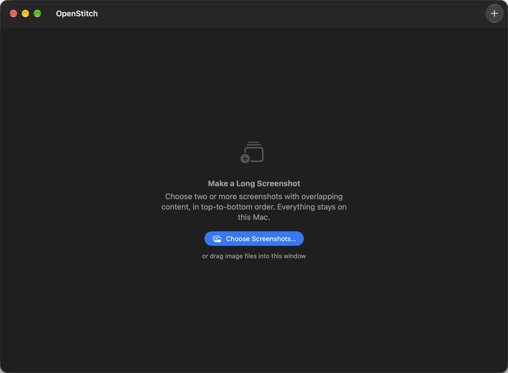
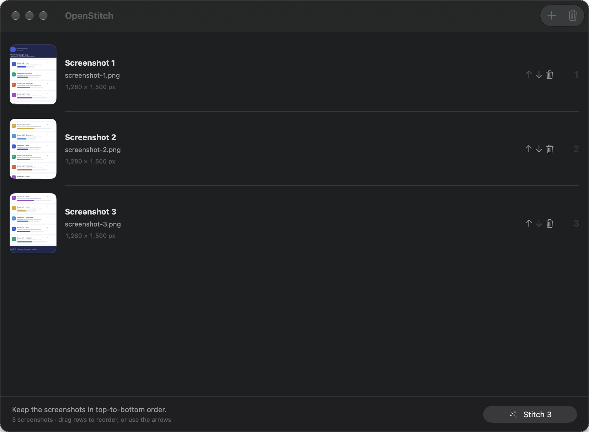
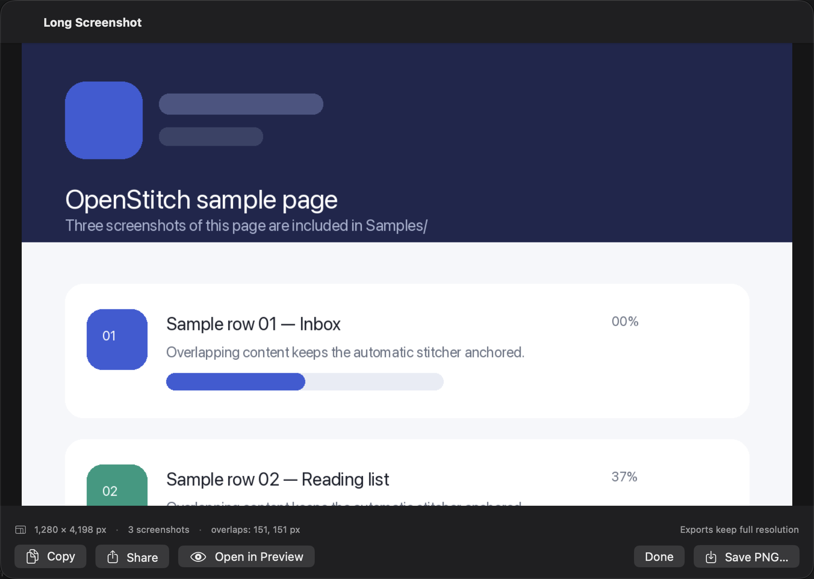

# OpenStitch4Mac

OpenStitch4Mac is a standalone, native macOS SwiftUI port of the iOS app OpenStitch — a
small, local-only long-screenshot stitcher. Add two or more vertically consecutive
screenshots, and it finds the overlapping content between each adjacent pair, removes the
duplicated rows, and renders one tall PNG.

It shares the iOS app's stitching engine and constants but is rebuilt for the Mac's
file-based workflow (`CGImage`/`CGContext`, AppKit interop). There is no account, no network
access, no upload, and no third-party library. Images are decoded and stitched entirely on
this Mac.

## Screenshots

Empty state:



Three screenshots imported, in top-to-bottom stitch order:



Result sheet for the bundled samples (footer: 1,280 × 4,198 px, 3 screenshots, overlaps
151 and 151 px; the preview starts at the top of the long image):



## Features on macOS

| Feature | Behaviour |
|---|---|
| Import | File picker (`⌘O` / **Choose Screenshots…**), drag & drop onto the window, Finder **Open With → OpenStitch**, Dock icon drop, or file arguments on the command line. |
| Limits | 2–20 screenshots in total per workspace. Extra files are truncated with a warning. |
| Order | The numbered list is the stitch order (top to bottom). Drag rows, use the per-row ↑/↓ buttons, or delete a row. |
| Overlap detection | Automatic for every adjacent pair; no manual offset entry. |
| Width normalisation | Every screenshot is normalised to the first screenshot's pixel width before stitching (matching widths are left untouched). |
| Preview | Scrollable, fit-to-width preview of the whole result, drawn directly from the full-resolution image (no downscaled preview copy), so tall results stay sharp up to the 60,000 px cap. |
| Export | Save the full-resolution PNG via a native save panel, copy the image to the clipboard, share the PNG through the system ShareLink, or open it in Preview. |
| Errors | Unreadable files, images that do not overlap, and results over the height cap produce explicit alerts instead of a silently wrong image. |
| Window model | One window, one workspace, no "New Window" item. Long operations run off the main thread with a progress overlay. |

### Keyboard shortcuts

| Shortcut | Action |
|---|---|
| `⌘O` | Add screenshots… |
| `⌘↩` | Stitch screenshots |
| `⌘E` | Show the result sheet again |
| `⌘S` | Save the PNG (in the result sheet) |
| `Esc` | Close the result sheet |
| `⇧⌘⌫` | Clear all screenshots |

## Requirements

| Item | Requirement |
|---|---|
| macOS | 14.0 or later (`MACOSX_DEPLOYMENT_TARGET = 14.0`) |
| Xcode | 16 or later (Swift 6 language mode). This repo was built and verified with Xcode 27.1 / Swift 6.4 on macOS 27.2. |
| Signing | None needed for local use. Builds in this repo use `CODE_SIGNING_ALLOWED=NO` (unsigned/linker-signed, not notarised). |

## Build & run

From the repository root:

```bash
xcodebuild \
  -project OpenStitch.xcodeproj \
  -scheme OpenStitch \
  -configuration Debug \
  -derivedDataPath build \
  CODE_SIGNING_ALLOWED=NO \
  build

open build/Build/Products/Debug/OpenStitch.app
```

Or open `OpenStitch.xcodeproj` in Xcode, select the **OpenStitch** scheme and press `⌘R`.

The built app is a normal `.app` bundle; it is not sandboxed, so it can read any file you
pick or drop. That is fine for local use, but the current build is not configured for
App Store distribution (no sandbox entitlements, no notarisation).

## Usage

1. Launch **OpenStitch**.
2. Add 2–20 screenshots in top-to-bottom order:
   - click **Choose Screenshots…** (or `⌘O`) and select files, or
   - drag image files from Finder into the window, or
   - select files in Finder and use **Open With → OpenStitch**.
3. Check the numbered list. Drag rows to reorder, or use the ↑/↓ buttons; use the trash
   button to remove a mistaken file. The list order is the stitch order.
4. Click **Stitch N** (`⌘↩`).
5. Review the result sheet: dimensions, screenshot count, detected overlaps, and the
   scrollable long-image preview.
6. Export with **Save PNG…** (`⌘S`), **Copy**, **Share**, or **Open in Preview**.
7. Click **Done** (`Esc`) to return to the list. The result stays available via
   **Show Result** (`⌘E`) until the screenshot list changes.

> The macOS file picker returns files in Finder display order (usually file name), not in
> the order you clicked them. If the picker hands you files out of order, fix it with drag
> reordering or the arrow buttons before stitching.

### Command line / automation

The app accepts image paths as arguments, which open through the same importer:

```bash
open -n -a build/Build/Products/Debug/OpenStitch.app \
  Samples/screenshot-1.png Samples/screenshot-2.png Samples/screenshot-3.png
```

Debug builds also support a verification hook that imports the supplied files and stitches
immediately:

```bash
launchctl setenv OPENSTITCH_AUTOSTITCH 1
open -n -a build/Build/Products/Debug/OpenStitch.app \
  Samples/screenshot-1.png Samples/screenshot-2.png Samples/screenshot-3.png
sleep 8
launchctl unsetenv OPENSTITCH_AUTOSTITCH
```

The hook is compiled only in `DEBUG` and exists for scripted screenshot/verification runs.

## Samples

`Samples/` contains a three-screenshot demo of one long page, plus the reference image:

| File | Size | Purpose |
|---|---|---|
| `Samples/screenshot-1.png` | 1,280 × 1,500 px | Top screen |
| `Samples/screenshot-2.png` | 1,280 × 1,500 px | Middle screen, 150 px overlap with #1 |
| `Samples/screenshot-3.png` | 1,280 × 1,500 px | Bottom screen, 150 px overlap with #2 |
| `Samples/sample-page-full.png` | 1,280 × 4,200 px | Reference page the samples were cropped from |

Stitching the three samples gives **1,280 × 4,198 px** with overlaps **151, 151** (the two
rows below 4,200 px come from overlap rounding). To regenerate the samples:

```bash
python3 Scripts/make_samples.py   # requires Pillow
```

## How stitching works

The macOS engine is a one-to-one port of the iOS `ImageStitcher`; only the image types
changed (`CGImage`/`CGContext` instead of `UIImage`/`UIGraphicsImageRenderer`).

1. **Normalise widths.** Every image after the first is scaled (high interpolation, white
   background) to the first image's pixel width, keeping its aspect ratio.
2. **Downsample for analysis.** Each image is redrawn as an 8-bit grayscale image 144 px
   wide. All comparisons happen on these small copies.
3. **Search overlaps.** For each adjacent pair, the bottom `rows` of the upper analysis
   image are compared with the top `rows` of the lower one, for every `rows` between 8% and
   92% of the shorter image's analysis height (minimum 8 rows). 8% of the width is ignored
   on both sides to avoid scrollbars and rounded edges.
4. **Score a candidate.** For each row, compute the mean absolute difference over the
   central 92% of the width, normalised to 0…1; sort the rows and keep the best 90%
   (ignores a blinking cursor, scroll indicator, or a single changing row); average them.
   Candidates below **0.105** are accepted, with a tiny bias (`rows × 0.000002`) toward
   longer matches so flat regions do not win by chance.
5. **Scale back.** The winning overlap height is converted from analysis pixels to source
   pixels (`sourceHeight / analysisHeight`, rounded).
6. **Render top to bottom.** Output width is the first image's width; output height is
   `first.height + Σ(next.height − overlap)`. Tiles are drawn in order at full resolution
   with the duplicates removed. The canvas is filled white first, so transparent input
   pixels composite onto white. Results taller than **60,000 px** are rejected with an
   explicit error.

The engine is UI-free and can be compiled and exercised on its own (see below).

## Saving, export and sharing

| Action | What it does |
|---|---|
| **Save PNG…** (`⌘S`) | Opens a native save panel (`NSSavePanel`, PNG only, default name `OpenStitch-yyyy-MM-dd-HHmmss.png`) and writes the stitched image at full resolution, off the main thread. |
| **Copy** | Puts the full image on the general pasteboard as an `NSImage`, ready to paste into other apps. |
| **Share** | `ShareLink` on a temporary PNG written to the system temporary directory, so Mail, Messages, AirDrop and the rest receive a real file. The OS manages the temp file. |
| **Open in Preview** | Opens that same temporary PNG with `NSWorkspace`, i.e. in the default image app. |
| **Done** (`Esc`) | Dismisses the sheet; exports are unaffected. |

The preview itself is display-only and never used as the export source — saved and shared
files always keep the stitched pixel dimensions.

## Testing & verification

Unit and adversarial tests (26 in total: 7 engine tests + 19 QA adversarial tests):

```bash
xcodebuild test \
  -project OpenStitch.xcodeproj \
  -scheme OpenStitch \
  -configuration Debug \
  -destination 'platform=macOS' \
  -derivedDataPath build \
  CODE_SIGNING_ALLOWED=NO
```

The standalone engine harness compiles the real stitching sources with `swiftc` (no
AppKit/SwiftUI), stitches the bundled samples, and pixel-compares the output against
`Samples/sample-page-full.png`. Build and run it from the repo root:

```bash
mkdir -p Verification/out
swiftc -O -swift-version 5 \
  OpenStitch/Stitching/ImageStitcher.swift \
  OpenStitch/Stitching/ImageLoader.swift \
  Verification/main.swift \
  -o Verification/out/stitch-cli
./Verification/out/stitch-cli
```

It also supports helper modes such as `--make-solid <path> R G B W H` for generating
no-overlap fixtures. `Verification/winlist.swift` is a tiny `CGWindowList` helper used to
find window ids for `screencapture -l <id>` during UI verification.

Results from the independent checks are in [QA-REPORT.md](QA-REPORT.md) and
[REVIEW.md](REVIEW.md). Both reports describe the baseline port; their actionable findings
(tall-result preview, document types for Finder, total screenshot cap, import/stitch races,
accessibility labels) were addressed in the follow-up commit `cf88906`.

## Project structure

```
OpenStitch.xcodeproj/          Xcode project (app + test target, shared scheme)
OpenStitch/
  OpenStitchApp.swift          App/scene, menu commands, keyboard shortcuts
  AppDelegate.swift            Finder open / Dock drop / command-line file handling
  Info.plist                   Bundle metadata, registers as an alternate public.image viewer
  Assets.xcassets/             App icon
  Model/StitchWorkspace.swift  Observable workspace: import, reorder, stitch, errors
  Stitching/ImageStitcher.swift  Overlap detection + CoreGraphics renderer
  Stitching/ImageLoader.swift    ImageIO loading (EXIF-aware), thumbnails, PNG encoding
  Stitching/ImageExporter.swift  Save panel, clipboard, open-in-Preview helpers
  Views/ContentView.swift      Empty state, list, toolbar, drag & drop, result sheet
  Views/ScreenshotRow.swift    One ordered list row
  Views/ResultView.swift       Result sheet and export actions
  Views/LongImagePreview.swift Fit-to-width NSScrollView preview
OpenStitchTests/               ImageStitcherTests (7) + QAExtraTests (19)
Samples/                       Demo screenshots and reference long page
Scripts/make_samples.py        Regenerates Samples/ (Pillow)
Scripts/make_icon.py           Regenerates the AppIcon asset sizes (Pillow)
Verification/                  Standalone engine harness, window-list helper, QA evidence
docs/screenshots/              Documentation screenshots
QA-REPORT.md, REVIEW.md        Independent QA and code-review reports
```

`build/`, `Verification/out/`, and `Verification/*.png` are generated/ignored artifacts.

## iOS → macOS mapping

| iOS original | macOS port |
|---|---|
| `PhotosPicker` with ordered selection, 2–20 images | `.fileImporter([.image], multiple)` / drag & drop / Finder **Open With** / command-line arguments; 20-image cap applies to the whole workspace |
| Photos library picker order preserved | macOS panel returns display order; the list offers drag reorder and ↑/↓ buttons to correct it |
| "Save to Photos" | `NSSavePanel` PNG export at full resolution (plus clipboard) |
| `UIActivityViewController` share sheet | `ShareLink` on a temporary PNG, plus **Copy** and **Open in Preview** |
| `fullScreenCover` result screen | macOS sheet over the single window |
| `NavigationStack` list with same ordering controls | `NavigationStack` + `List` with drag reorder, per-row ↑/↓ and delete |
| 20-image and 60,000 px limits | Same limits, with an explicit alert when either is hit |
| `UIColor.systemBackground` fill behind tiles | Always white — predictable for alpha-bearing inputs and OCR-friendly exports (deliberate deviation) |
| `UIImage` + `UIGraphicsImageRenderer` | `CGImage` + `CGContext` (bottom-left origin handled explicitly) |
| No photo-library read permission needed | No photo-library access at all: the app only reads files you explicitly open |
| Everything on-device | Everything on-device; no networking code in the target |

## Privacy

- **No network.** The app target contains no URLSession / networking code and makes no
  outbound connections. There is no account, telemetry, analytics, or third-party SDK.
- **Local decoding.** Images are read with ImageIO from the files you choose; the decoded
  pixels never leave the Mac.
- **Temporary share file.** For **Share** and **Open in Preview**, a PNG is written to the
  system temporary directory (`FileManager.default.temporaryDirectory`) and handed to the
  system; macOS owns its lifetime.
- **No persistence.** The workspace is in memory only; apart from the temporary share PNG,
  nothing is saved unless you use **Save PNG…**.

## Troubleshooting

| Symptom | Cause / fix |
|---|---|
| **"Could not find enough overlap between screenshots N and N+1."** | Too little common content: the pair was scrolled too far apart, the page/theme changed between shots, or the files are not really consecutive. Keep at least ~10% of the screen height visible in both shots and don't change content between captures. |
| **"The result is too tall to render."** | The stitched height would exceed 60,000 px. Use fewer screenshots or split the capture into two runs. |
| **"Screenshot N could not be read."** | The file is corrupt, unsupported, or not actually an image. Re-export it as PNG/JPEG and re-add it. |
| **Files are in the wrong order after importing.** | The macOS picker returns display order. Reorder with drag or the ↑/↓ buttons; the numbered list is the stitch order. |
| **"Couldn’t add screenshots"** | The selection had no decodable images (wrong file type, unreadable file). Supported formats are whatever ImageIO can decode — PNG, JPEG, HEIC, TIFF, GIF, BMP and friends. |
| **Stitch is very slow or memory-heavy.** | Up to 20 screenshots are decoded and rendered at once. Expect longer for full-resolution captures (the engine test with 20 small 240×400 images takes ~4.4 s); use fewer/lighter images for very large captures. |
| **Preview looks narrower than the sheet.** | It never upscales: a very narrow screenshot is shown at its natural width, centred. Export is always full resolution. |
| **Result is 2 px shorter than expected (4,198 vs 4,200).** | Overlap heights are rounded to source pixels, so each seam can lose a row. This is expected. |

## Limitations

- The preview is fit-to-width with vertical scrolling only — there is no zoom or pan control.
- No in-app photo library or file browser; images are added through the picker, drag & drop,
  Finder, or the command line.
- One workspace and one stitch at a time; importing is disabled while a stitch is running.
- The shipping configuration here is a local Debug build: unsandboxed, unsigned/linker-signed,
  not notarised, no App Store packaging.
- Stitching is pixel-based: flat or visually repetitive content can make the overlap
  ambiguous, and strongly correlated non-matching images are a known residual risk of the
  0.105 heuristic (inherited from the iOS original).

## License

OpenStitch4Mac is released under the Apache License 2.0. See [LICENSE](LICENSE) for the
full text.
